# ParkEase – Smart Parking Reservation System

A complete, responsive web application built with **ASP.NET Core MVC**, **C#**, **Entity Framework Core**, and **MySQL**.

ParkEase solves real-world urban parking congestion by allowing motorists to locate vacant parking bays, compare hourly rates, and reserve parking slots with guaranteed zero-conflict availability. Administrators can manage multi-level parking hubs, configure slot rates and maintenance states, monitor real-time occupancy statistics, and record vehicle check-ins and check-outs at entry and exit barriers.

---

## 🌟 Key Features

### 🚗 Customer Portal
- **Real-Time Slot Discovery**: Search parking bays across city hubs filtered by vehicle category (Car, Bike, SUV, EV with fast charging) and exact time windows.
- **Zero-Conflict Reservation**: Atomic database transactions prevent double bookings and overlapping time ranges on the server.
- **Automated Fare Calculation**: Transparent billing rounds up partial hours with rate protection locked at booking time.
- **Digital Permit & Receipt**: Generates unique references (`PK-YYYYMMDD-XXXXXX`) with print-ready digital passes for barrier entry.
- **My Bookings & Self-Service Cancellation**: Manage upcoming and previous reservations; cancel bookings in 1-click before arrival.
- **Personal Dashboard**: Track upcoming trips, on-site vehicles, and total parking expenditure.

### 🛡️ Administrator Console
- **Live 8-Metric KPI Dashboard**: Real-time counters for Total Slots, Available, Occupied/On-Site, Maintenance, Today's Bookings, Upcoming Confirmed, Completed Sessions, and Recorded Revenue.
- **Facility Hub Management**: Add and manage parking complexes with addresses, descriptions, and activation toggles.
- **Parking Slot Management**: Configure bay numbers, vehicle types, hourly rates, and instant toggles for "Available", "Unavailable", and "Maintenance".
- **Barrier Check-In & Check-Out Control**: Attendant interface to record vehicle arrival timestamps and departure times, automatically finalizing billable duration and charges.
- **Financial Distinction**: Explicitly separates realized revenue (from closed check-outs) from active booking estimates.
- **Motorist Support Inbox**: Review and triage inquiries submitted through the contact page.

---

## 📸 Application Screenshots Gallery

### 🚗 Customer Portal

| Landing Page | Live Slot Discovery |
|:---:|:---:|
| 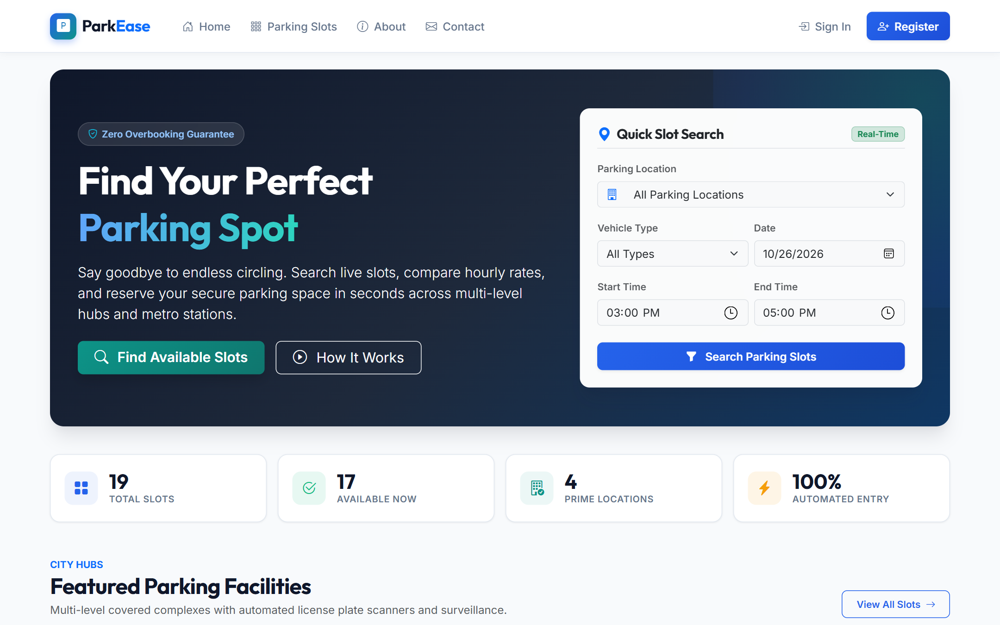 | 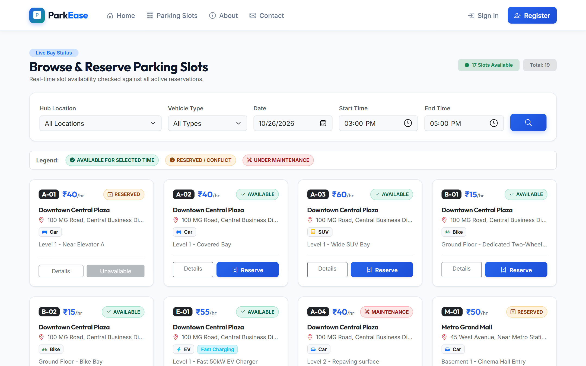 |
| *Modern hero section & featured city hubs* | *Filter bays by vehicle category & time window* |

| Customer Dashboard | Digital Parking Permit |
|:---:|:---:|
| 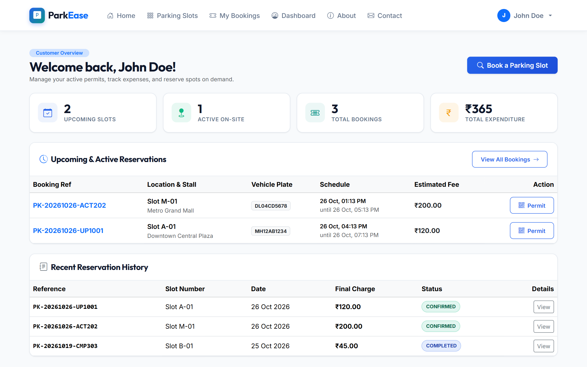 | 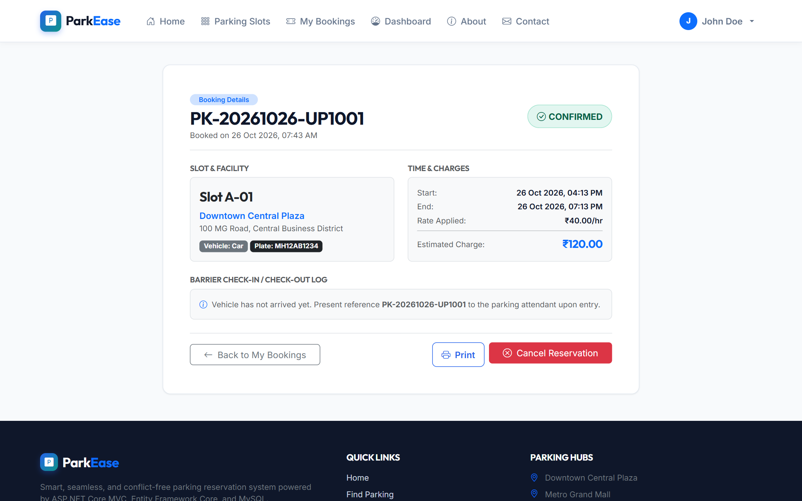 |
| *Active trips, on-site status & quick actions* | *Print-ready digital pass with QR code & booking ref* |

| Booking Reservation Modal | My Bookings History |
|:---:|:---:|
| 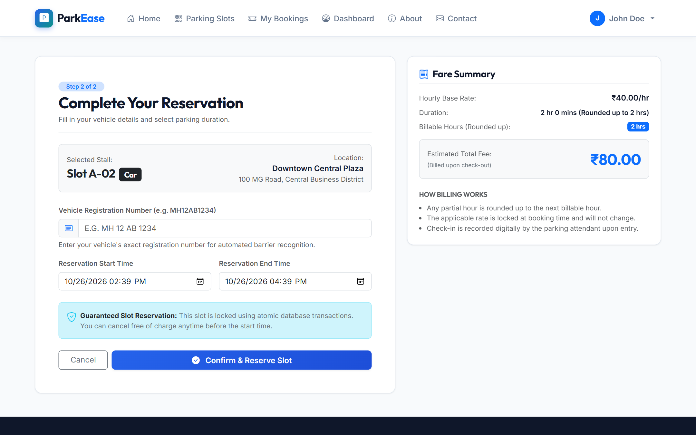 | 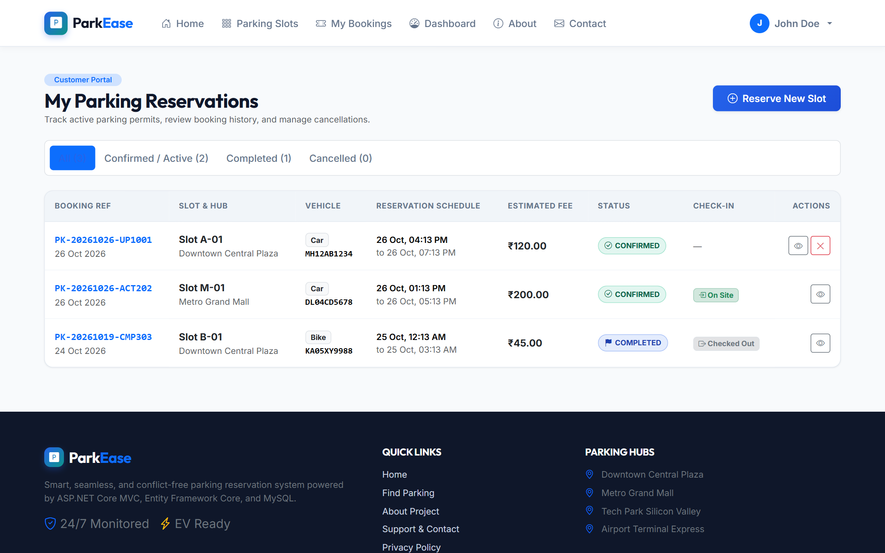 |
| *Transparent real-time fare calculation* | *Trip history with self-service cancellation* |

### 🛡️ Administrator Console

| Live 8-Metric KPI Dashboard | Barrier Check-In & Check-Out |
|:---:|:---:|
| 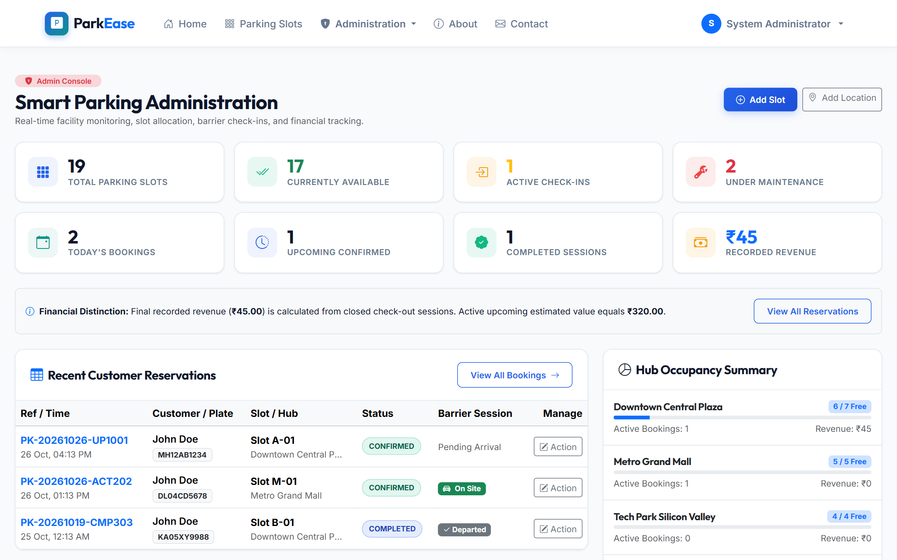 | 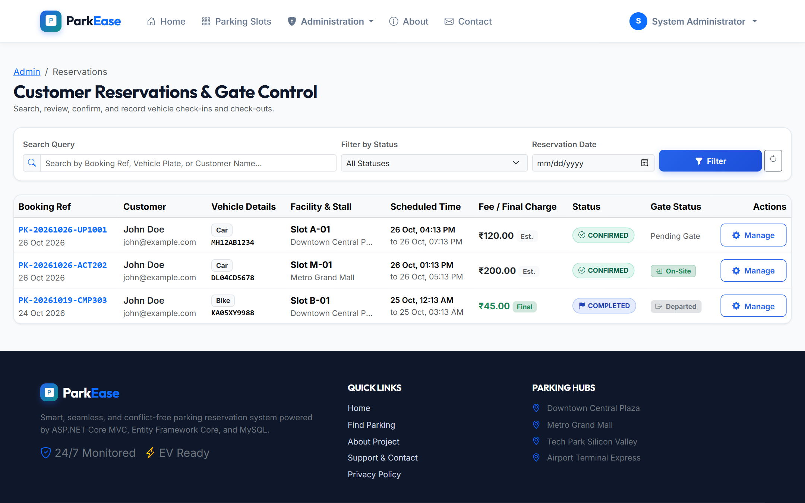 |
| *Real-time occupancy, revenue & session analytics* | *Barrier attendant check-in/out timestamp logging* |

| Parking Bay Inventory Management | Multi-Level Facility Hubs |
|:---:|:---:|
| 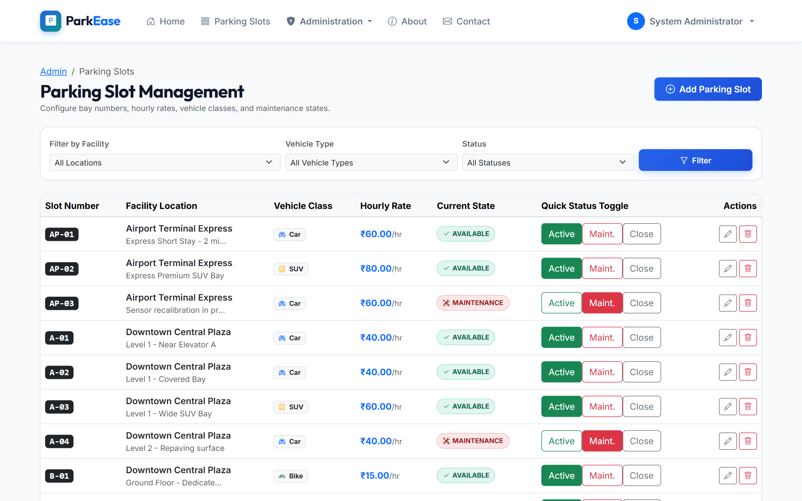 | 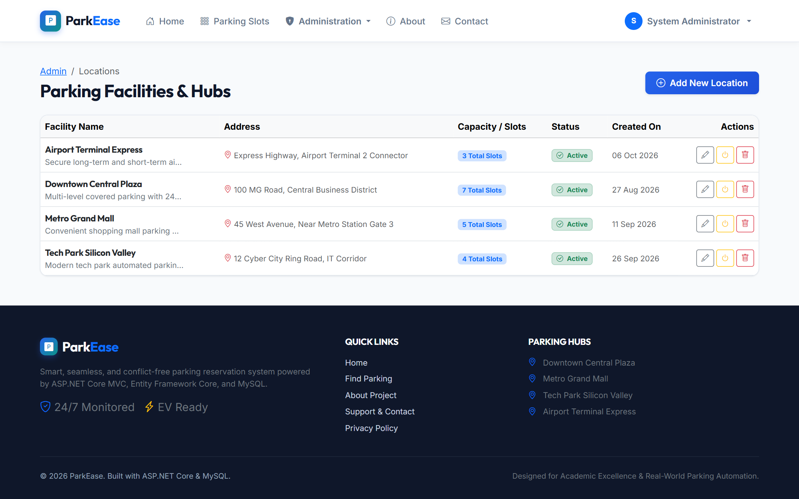 |
| *Configure rates and toggle Maintenance / Available states* | *Manage parking locations, addresses & capacities* |

### 🔐 Authentication & Support

| Quick-Fill Demo Login | Motorist Contact & Inquiries |
|:---:|:---:|
| 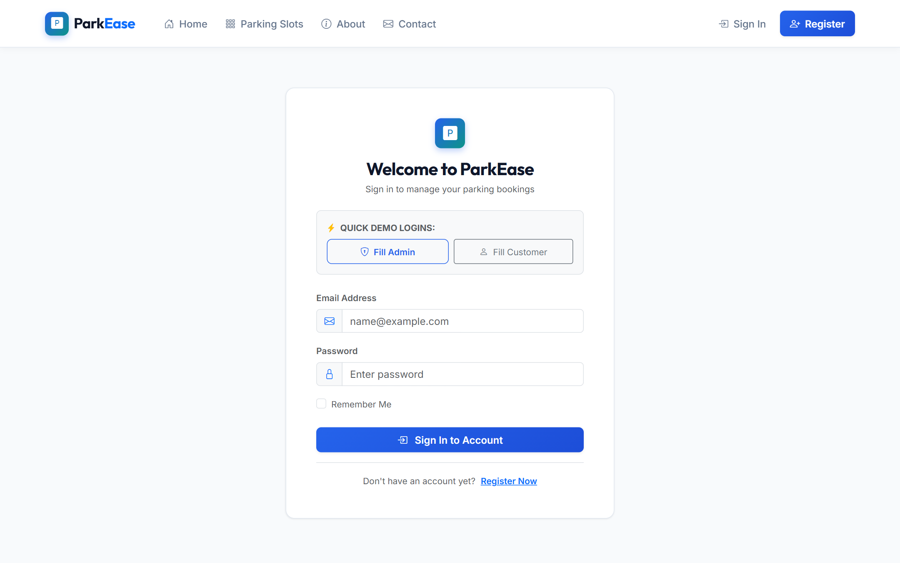 | 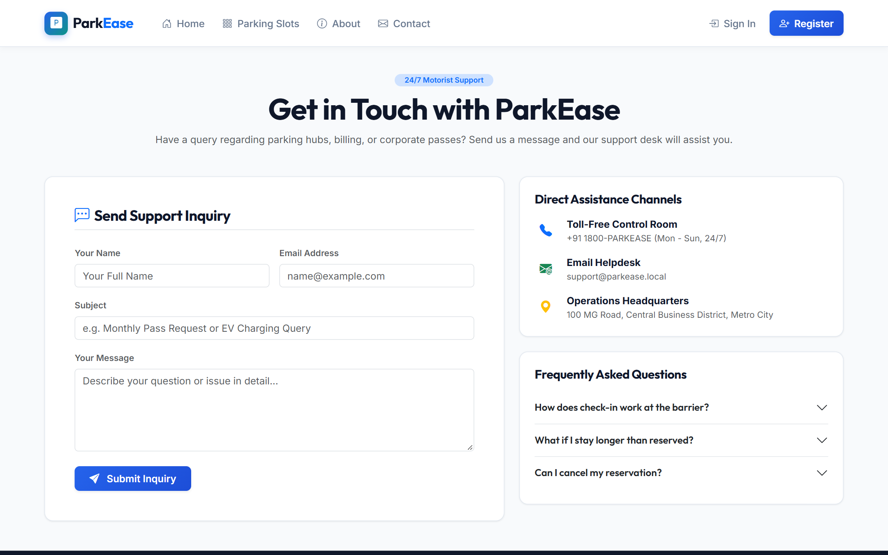 |
| *1-Click Demo login buttons for Admin & Customer* | *Integrated inquiry and customer feedback form* |

---

## 🛠️ Technology Stack

| Component | Technology |
|---|---|
| **Web Framework** | ASP.NET Core MVC (C#) |
| **Target Runtime** | .NET 8 / .NET 10 |
| **ORM / Data Access** | Entity Framework Core Code-First |
| **MySQL Provider** | `Pomelo.EntityFrameworkCore.MySql` |
| **Database** | MySQL Server 8.0+ / MariaDB (XAMPP / WAMP) |
| **Security & Identity** | ASP.NET Core Identity (PBKDF2 Hashing, Cookie Auth, Roles) |
| **Frontend Styling** | Bootstrap 5, Bootstrap Icons, Custom Design System (`site.css`) |
| **Typography** | Google Fonts (Outfit & Inter) |
| **State Management** | Distributed Session, TempData, Auth Cookies, Query Strings |

---

## 🔑 Default Credentials (Auto-Seeded)

| Role | Email Address | Password | Permissions |
|---|---|---|---|
| **Administrator** | `admin@parkease.com` | `Admin@123` | Full access to Admin Console, Slot Management, Hubs, Barrier Check-in/out |
| **Customer (Demo)** | `john@example.com` | `User@123` | Search, reserve, customer dashboard, booking history, cancellation |

> **Tip:** The Login page includes **"Fill Admin"** and **"Fill Customer"** 1-click buttons for quick demonstration.

---

## 🚀 Step-by-Step Setup & How to Run

### Prerequisites
1. **.NET SDK** (8.0 or compatible later version).
2. **MySQL Server** running on `localhost:3306` (e.g., via **XAMPP**, **WAMP**, or standalone MySQL Server).
3. **Visual Studio 2022** or **Visual Studio Code** (with C# Dev Kit).

### 1. Database Configuration
By default, the application connects to MySQL on localhost:
```json
"ConnectionStrings": {
  "DefaultConnection": "Server=localhost;Port=3306;Database=parkease_db;User=root;Password=;CharSet=utf8mb4;"
}
```
*If your MySQL instance has a root password, update `Password=YOUR_PASSWORD;` in `appsettings.json`.*

### 2. Apply Migrations & Seed Database
Open PowerShell / Terminal in the project root folder:
```powershell
# Restore dependencies and build
dotnet build

# Apply EF Core migrations to MySQL
dotnet ef database update
```
*(The application will automatically run `DbInitializer.SeedAsync` on first launch to create roles, admin, customer, 4 hubs, 17 slots, and sample reservations).*

### 3. Run the Application
```powershell
dotnet run --launch-profile http
```
Access the application in your browser at:
👉 **`http://localhost:5283`**

---

## 🗄️ Database Architecture & Relationships

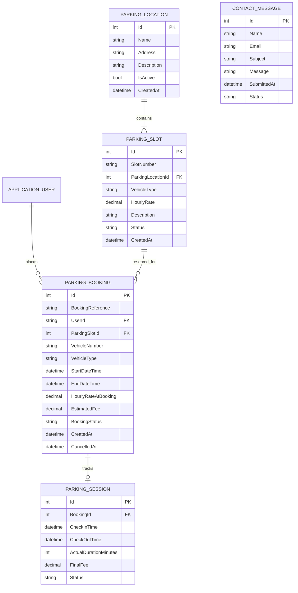

---

## 🧪 Comprehensive Test Scenarios Verified

| # | Test Scenario | Expected Outcome | Verification Status |
|---|---|---|---|
| **1** | User Registration & Login | ASP.NET Identity validates passwords, issues auth cookie | ✅ Verified |
| **2** | Role-Based Authorization | Admin pages restricted to `[Authorize(Roles = "Admin")]` | ✅ Verified |
| **3** | Slot Search & Filters | Filters by Location, Vehicle Type, Date, Start/End times | ✅ Verified |
| **4** | Server Fare Calculation | Rounds partial hours up; ₹40/hr for 2h20m = 3h = ₹120.00 | ✅ Verified |
| **5** | Double Booking Conflict Check | Overlapping reservations for same slot rejected on server | ✅ Verified |
| **6** | Maintenance Slot Exclusion | Slots under maintenance cannot be booked | ✅ Verified |
| **7** | Digital Permit Generation | Unique `PK-YYYYMMDD-XXXXXX` generated with print preview | ✅ Verified |
| **8** | Self-Service Cancellation | Confirmed booking cancelled releases slot immediately | ✅ Verified |
| **9** | Ownership Isolation | Users cannot view or cancel bookings of other users | ✅ Verified |
| **10** | Barrier Check-In & Check-Out | Timestamps recorded; actual minutes billed; status completed | ✅ Verified |
| **11** | Contact Inquiry Form | Inquiries validated and saved to `contactmessages` table | ✅ Verified |
| **12** | Live Admin KPI Metrics | Accurately calculates active check-ins and revenue | ✅ Verified |

---

## 📁 Project Directory Structure

```
ParkEase/
├── Controllers/
│   ├── HomeController.cs           # Landing page, About, Privacy
│   ├── AccountController.cs        # Login, Register, Profile, AccessDenied
│   ├── ParkingController.cs        # Slot browsing, search, and details
│   ├── BookingsController.cs       # Reservation form, confirmation, cancellations
│   ├── DashboardController.cs      # Customer dashboard
│   ├── ContactController.cs        # Motorist contact inquiries
│   ├── AdminController.cs          # Administrator overview and statistics
│   ├── AdminLocationsController.cs # CRUD operations for hubs
│   ├── AdminSlotsController.cs     # CRUD & status toggles for slots
│   └── AdminBookingsController.cs  # Reservation search, check-in, check-out
├── Data/
│   ├── ApplicationDbContext.cs    # EF Core DbContext with model configurations
│   ├── DbInitializer.cs           # Automatic seeding of roles, users, slots, bookings
│   └── Migrations/                # Code-First database migrations
├── Models/
│   ├── ApplicationUser.cs         # Extends IdentityUser
│   ├── ParkingLocation.cs         # Hub entity
│   ├── ParkingSlot.cs             # Stall entity
│   ├── ParkingBooking.cs          # Reservation entity
│   ├── ParkingSession.cs          # Check-in/out session entity
│   └── ContactMessage.cs          # Inquiries entity
├── ViewModels/
│   ├── AccountViewModels.cs       # Register, Login, Profile
│   ├── ParkingSearchViewModel.cs  # Search filters and slot cards
│   ├── BookingViewModels.cs        # Reservation create, details, my bookings
│   └── DashboardViewModels.cs      # Admin, Customer, Contact view models
├── Services/
│   ├── FeeCalculationService.cs   # Billable hours rounding and fee math
│   ├── ParkingAvailabilityService.cs # Overlap queries and availability engine
│   └── BookingService.cs          # Transactional booking, check-in, check-out
├── Views/
│   ├── Home/                      # Index, About, Privacy
│   ├── Account/                   # Login, Register, Profile, AccessDenied
│   ├── Parking/                   # Index, Details
│   ├── Bookings/                  # Create, Confirmation, MyBookings, Details
│   ├── Dashboard/                 # Index (Customer Dashboard)
│   ├── Contact/                   # Index (Inquiries form)
│   ├── Admin/                     # Index (Admin KPI Dashboard)
│   ├── AdminLocations/            # Index, Create, Edit
│   ├── AdminSlots/                # Index, Create, Edit
│   ├── AdminBookings/             # Index, Details
│   └── Shared/                    # _Layout.cshtml, _ValidationScriptsPartial.cshtml
├── wwwroot/
│   ├── css/site.css               # Modern design system (Google Fonts, glassmorphism)
│   └── js/site.js                 # Dynamic fare calculator, demo fill, print helper
├── appsettings.json               # MySQL connection string and logging
└── Program.cs                     # Service registrations and HTTP pipeline
```

---

## 🎓 Academic Project Report Summary
A full project report detailing the **Abstract**, **Objectives**, **Scope**, **Methodology**, **Architecture**, **Database Schema**, **Test Cases**, and **Conclusion** is included in the project documentation artifacts.
